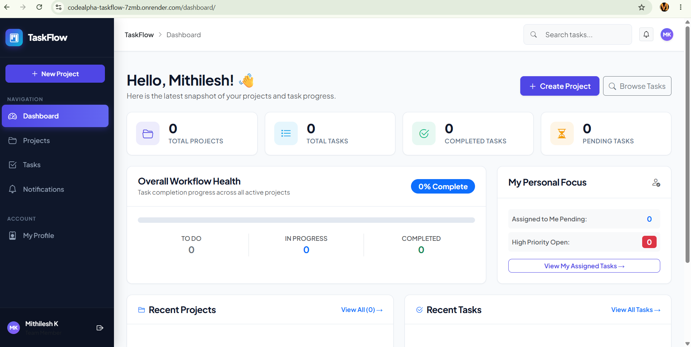

# TaskFlow - Full-Stack Project Management Tool

**TaskFlow** is a modern, responsive, and robust Project Management Tool built with **Django 4.2**, **Python 3.9**, **SQLite**, **Bootstrap 5**, and custom interactive JavaScript.

Developed for **CodeAlpha Internship Task 3**.

---

## 📌 Project Overview

TaskFlow enables teams and individuals to organize projects, assign and manage tasks, track progress across interactive Kanban boards, communicate via task discussions, and receive live in-app notifications.
**Live Demo:** https://codealpha-taskflow-7zmb.onrender.com

**GitHub Repository:** https://github.com/madhumithileshk-collab/CodeAlpha_TaskFlow
## 📸 Screenshots



---

## 🚀 Key Features

### 1. User Authentication & Profile
- User registration with validation and password encryption.
- Secure login and session handling.
- Safe logout and redirection.
- Custom user profile with avatars/initials, roles (e.g. Developer, Lead, Designer), phone, and bio.
- Permission enforcement: unauthenticated users cannot access workspace projects or tasks.

### 2. Project Management
- Create new projects with target deadlines and descriptions.
- Status management: `Planning`, `In Progress`, `Completed`, `On Hold`.
- Add registered users to project teams with roles (`Owner`, `Admin`, `Member`).
- Real-time progress bars calculating the percentage of completed tasks.
- Edit and delete projects with confirmation prompts (restricted to creators/admins).

### 3. Task Management
- Create tasks tied directly to projects.
- Assign tasks to project team members.
- Priorities: `Low`, `Medium`, `High` with visual badges.
- Status workflow: `To Do`, `In Progress`, `Completed`.
- Quick one-click status transitions directly from the dashboard and task board.
- Due date tracking with automatic overdue warnings.

### 4. Interactive Comments & Collaboration
- Dedicated comment feed on each task.
- Displays author name, avatar, relative timestamp ("2 hours ago"), and message.
- Instant notifications sent to task assignees and creators when a comment is posted.
- Authors and project managers can delete comments.

### 5. Executive Dashboard
- **Total Projects**, **Total Tasks**, **Completed Tasks**, and **Pending Tasks** stat cards.
- **Visual Progress Bar** showing overall workspace completion percentage.
- **My Personal Focus** widget highlighting tasks assigned to the current user and high-priority items.
- Recent projects summary list with direct navigation.
- Recent tasks table with inline status update selectors.

### 6. In-App Notifications
- Instant alerts when:
  - A task is assigned to a user.
  - A user is added to a project team.
  - A comment is posted on a task.
  - A task's status is updated.
- Navbar notification bell dropdown with real-time unread badges.
- Dedicated **Notifications Hub** to review and mark all as read.

### 7. Search & Filtering
- Search projects by title and description.
- Filter projects by status (`Planning`, `In Progress`, `Completed`, `On Hold`).
- Search tasks across all projects by keywords.
- Multi-dimensional task filters: by **Status**, by **Priority**, by **Project**, or quick toggle for **Assigned to Me**.

### 8. Django Admin Panel
- Fully registered models: `User Profiles`, `Projects`, `Project Members`, `Tasks`, `Comments`, and `Notifications`.
- Tabular inlines for project members, tasks, and task comments.
- Search filters, date hierarchy, and autocomplete fields.

---

## 🛠️ Technology Stack

- **Backend:** Python 3.9, Django 4.2.30 (MVT Architecture)
- **Database:** SQLite 3 (Django ORM)
- **Frontend:** HTML5, CSS3, JavaScript (ES6+), Bootstrap 5.3, Bootstrap Icons
- **Typography:** Plus Jakarta Sans & Inter (Google Fonts)

---

## 📁 Project Structure

```text
TaskFlow/
│
├── manage.py                   # Django CLI management script
├── requirements.txt            # Python dependencies
├── README.md                   # Complete documentation
│
├── taskflow/                   # Project configuration directory
│   ├── __init__.py
│   ├── asgi.py
│   ├── settings.py             # Project settings (Apps, DB, Templates, Static)
│   ├── urls.py                 # Main URL routing
│   └── wsgi.py
│
├── accounts/                   # Authentication & user profile app
│   ├── migrations/
│   ├── templates/accounts/
│   │   └── profile.html        # User profile & bio management
│   ├── __init__.py
│   ├── admin.py                # Admin configuration for Profile
│   ├── apps.py
│   ├── forms.py                # Registration, Login, Profile forms
│   ├── models.py               # Profile model with auto-create signal
│   ├── urls.py                 # Auth routes (login, register, logout, profile)
│   └── views.py                # Auth controllers
│
├── projects/                   # Core business logic app
│   ├── management/commands/
│   │   └── seed_data.py        # Demo dataset generator command
│   ├── migrations/
│   ├── static/projects/
│   │   ├── css/style.css       # Custom styling, variables, glassmorphic cards
│   │   └── js/main.js          # Sidebar toggle, tooltips, auto alerts
│   ├── templates/projects/
│   │   ├── project_list.html   # Projects directory with filters
│   │   ├── project_detail.html # Kanban board & project team
│   │   ├── project_form.html   # Project create/edit form
│   │   ├── project_confirm_delete.html
│   │   ├── task_list.html      # Tasks directory with multi-filters
│   │   ├── task_detail.html    # Task info, metadata, and comments feed
│   │   ├── task_form.html      # Task create/edit form
│   │   ├── task_confirm_delete.html
│   │   └── notification_list.html # Notifications hub
│   ├── __init__.py
│   ├── admin.py                # Admin configuration with inlines
│   ├── apps.py
│   ├── context_processors.py   # Global unread notifications badge
│   ├── forms.py                # ProjectForm, TaskForm, CommentForm, MemberForm
│   ├── models.py               # Project, ProjectMember, Task, Comment, Notification
│   ├── tests.py                # Comprehensive automated unit & integration tests
│   ├── urls.py                 # Project and Task URLs
│   └── views.py                # View controllers
│
└── templates/                  # Global templates
    ├── base.html               # Master layout with responsive sidebar & topbar
    ├── home.html               # Modern marketing & hero landing page
    ├── dashboard.html          # Analytics dashboard & metric cards
    ├── login.html              # Custom styled sign in
    └── register.html           # Custom styled registration
```

---

## ⚡ Quick Setup & Running Instructions (Windows)

### Step 1: Open Terminal in TaskFlow Directory
Open **PowerShell** or **Command Prompt** and ensure you are in the `TaskFlow` project folder:
```powershell
cd TaskFlow
```

### Step 2: Install Dependencies
Verify Python is installed, then install requirements:
```powershell
python -m pip install -r requirements.txt
```

### Step 3: Apply Database Migrations
Create and apply database tables:
```powershell
python manage.py makemigrations
python manage.py migrate
```

### Step 4: Populate Initial Demo Data (Optional but Recommended)
A custom management command is provided to instantly populate realistic projects, tasks, team members, comments, and notifications:
```powershell
python manage.py seed_data
```

### Step 5: (Optional) Create Your Own Admin Account
If you want to create a brand new custom superuser:
```powershell
python manage.py createsuperuser
```
Follow the prompts to enter a username, email, and password.

### Step 6: Start the Development Server

Run the following command in your terminal:

python manage.py runserver

Open your browser and visit:

http://127.0.0.1:8000/


## 🧪 Running Automated Tests

Run the built-in test suite to verify all endpoints, forms, models, and notifications:
```powershell
python manage.py test
```

Expected output:
```text
Ran 5 tests in 5.329s
OK
```

---

## 🛡️ License & Credits
Developed as part of the **CodeAlpha Internship Program - Task 3**.
Built with Django & Bootstrap 5.
